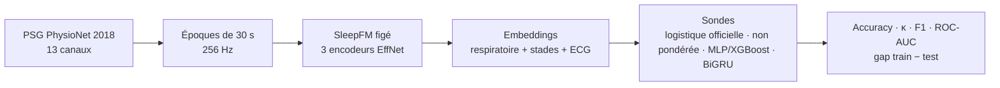

# SleepFM Pipeline

[](https://github.com/sumarc183-design/sleepfm-pipeline/actions/workflows/ci.yml)

[](https://docs.astral.sh/ruff/)
[](https://colab.research.google.com/github/sumarc183-design/sleepfm-pipeline/blob/main/notebooks/colab_baseline_physionet2018.ipynb)
[](https://kaggle.com/kernels/welcome?src=https://github.com/sumarc183-design/sleepfm-pipeline/blob/main/notebooks/colab_baseline_physionet2018.ipynb)

Reproduction et évaluation de [SleepFM](https://github.com/rthapa84/sleepfm-codebase),
modèle fondamental multimodal du sommeil, sur données ouvertes : stadification
en 5 classes (Wake, N1, N2, N3, REM) à partir des embeddings figés du
checkpoint officiel, avant toute comparaison à
[OSF](https://github.com/yang-ai-lab/OSF-Open-Sleep-FM) et tout développement
propriétaire.



## Résultats

Régression logistique **non pondérée** sur embeddings figés, split par sujet,
Colab GPU T4. ⚠️ Le protocole officiel pondère les classes
(`class_weight="balanced"`) : c'est désormais la baseline du pipeline, et ces
chiffres seront remplacés par ceux du prochain run (avec intervalles de
confiance).

| Date | Données | Sujets train / test | Accuracy | Cohen's κ | F1 macro |
|---|---|---|---|---|---|
| 2026-11-02 | PhysioNet 2018 | 15 / 5 | 0,703 | 0,584 | 0,650 |
| 2026-11-03 | PhysioNet 2018 | 75 / 25 (22 236 époques de test) | **0,722** | **0,622** | **0,681** |

F1 par stade (100 sujets) : Wake 0,741 · **N1 0,434** · N2 0,801 · N3 0,738 ·
REM 0,692. N1, stade de transition, est le plus difficile (c'est aussi le moins
concordant entre experts humains). Sorties brutes dans [`results/`](results/).

**Lecture** : référence interne, pas une reproduction du chiffre publié. Le
papier SleepFM rapporte la stadification sur MESA/SHHS, pas sur PhysioNet 2018 ;
la comparaison stricte se fera sur MESA (accès NSRR en cours). La comparaison
des sondes (pondérée, MLP ou XGBoost, BiGRU) est décrite dans le
[guide](docs/GUIDE.md#sondes-et-sélection-de-modèle).

## Démarrage rapide

**Sans installation** : bouton *Open in Colab* ci-dessus, `GPU T4`, `Tout exécuter`. Quota Colab épuisé : bouton *Open in Kaggle*, même notebook ([détails](docs/GUIDE.md#kaggle-autre-gpu-gratuit)).

**En local** :

```bash
pip install -r requirements-dev.txt
bash scripts/setup_sleepfm.sh   # checkpoint officiel best.pt
python scripts/download_physionet2018.py --out data/raw/physionet2018/training --limit 20
python run_baseline.py --raw-data data/raw/physionet2018/training \
    --checkpoint third_party/sleepfm/sleepfm/checkpoint/best.pt
pytest tests/                   # unitaires + bout-en-bout sur données synthétiques
```

Mode par lots pour 100 sujets et plus, détails des sondes, tests et points
d'attention : [docs/GUIDE.md](docs/GUIDE.md).

## Données

| Base | Accès | Usage |
|---|---|---|
| PhysioNet Challenge 2018 | Public (994 sujets annotés) | Validation du pipeline (phase 1) |
| MESA (NSRR) | Sur demande (DUA) | Reproduction du chiffre publié |
| SHHS (NSRR) | Sur demande (DUA) | Évaluation à plus grande échelle (phase 2) |
| CHAT (NSRR) | Sur demande (DUA) | Pédiatrie, piste de différenciation (phase 2) |

Procédure NSRR : [docs/DATA_ACCESS.md](docs/DATA_ACCESS.md).

## Structure

```
run_baseline.py   point d'entrée : split par sujet -> extraction -> embeddings -> sondes -> évaluation
src/data/         lecture et découpage des PSG en époques
src/models/       encodeurs SleepFM, sondes (logistique, MLP, XGBoost, BiGRU), backbone OSF
scripts/          téléchargement PhysioNet, setup SleepFM, générateur de données synthétiques
notebooks/        notebook Google Colab / Kaggle
tests/            tests unitaires, bout-en-bout synthétique, données réelles
results/          sorties des runs réels
configs/          conventions de référence (non lues par les scripts)
docs/             guide, carte du modèle, roadmap, accès NSRR, comparaison OSF
```

## Documentation

| Document | Contenu |
|---|---|
| [GUIDE.md](docs/GUIDE.md) | Installation, modes d'exécution, sondes, tests, pièges connus |
| [MODEL_CARD.md](docs/MODEL_CARD.md) | Usage prévu, données, métriques, limites |
| [ROADMAP.md](docs/ROADMAP.md) | Jalons J30 / J60 / J90 |
| [DATA_ACCESS.md](docs/DATA_ACCESS.md) | Demande d'accès NSRR (MESA, SHHS, CHAT) |
| [OSF_COMPARISON.md](docs/OSF_COMPARISON.md) | Ce qu'il faut aligner avant de comparer SleepFM et OSF |
| [CHANGELOG.md](CHANGELOG.md) | Historique des versions |

## Attributions

Code de modèle et d'extraction adapté de SleepFM et d'OSF (licences MIT) :
voir [THIRD_PARTY_NOTICES.md](THIRD_PARTY_NOTICES.md). Pour citer ce travail :
[CITATION.cff](CITATION.cff).

⚠️ Projet de recherche, pas un dispositif médical.
