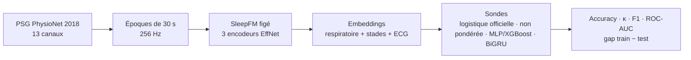

# SleepFM Pipeline

[](https://github.com/sumarc183-design/sleepfm-pipeline/actions/workflows/ci.yml)

[](https://docs.astral.sh/ruff/)
[](https://colab.research.google.com/github/sumarc183-design/sleepfm-pipeline/blob/main/notebooks/colab_baseline_physionet2018.ipynb)
[](https://kaggle.com/kernels/welcome?src=https://github.com/sumarc183-design/sleepfm-pipeline/blob/main/notebooks/colab_baseline_physionet2018.ipynb)

Reproduction et évaluation de [SleepFM](https://github.com/rthapa84/sleepfm-codebase),
modèle fondamental multimodal du sommeil, sur données ouvertes : stadification
en 5 classes (Wake, N1, N2, N3, REM) à partir des embeddings figés du
checkpoint officiel, avant toute comparaison à
[OSF](https://github.com/yang-ai-lab/OSF-Open-Sleep-FM) et tout développement
propriétaire.



## Résultats

100 sujets PhysioNet 2018, split 80/20 **par sujet** (80 nuits d'entraînement,
20 de test, 17 818 époques de test), embeddings SleepFM figés, 2026-11-04. Le
test n'a servi qu'une fois ; IC à 95 % par bootstrap sur les sujets de test.

| Sonde (test) | Accuracy | Cohen's κ [IC 95 %] | F1 macro [IC 95 %] | ROC-AUC | Gap F1 train − test |
|---|---|---|---|---|---|
| **Régression logistique pondérée** (baseline officielle) | 0,693 | **0,606** [0,545 ; 0,669] | 0,683 [0,628 ; 0,728] | 0,925 | +0,070 |
| Régression logistique non pondérée | 0,738 | 0,646 [0,579 ; 0,703] | 0,698 [0,643 ; 0,741] | 0,927 | +0,062 |
| MLP (retenu face à XGBoost) | 0,714 | 0,623 [0,555 ; 0,685] | 0,683 [0,629 ; 0,726] | 0,924 | +0,085 |
| **BiGRU sur la nuit** | **0,764** | **0,684** [0,615 ; 0,739] | **0,737** [0,673 ; 0,779] | **0,936** | +0,057 |

- **Le contexte de la nuit est le levier** : le BiGRU, qui voit les époques
  voisines, gagne +0,08 de κ sur la baseline et le meilleur F1 sur chaque
  stade sauf l'éveil (REM 0,80 contre 0,68). Le gain est **significatif** en
  comparaison appariée (mêmes nuits de test, bootstrap sur les sujets) :
  κ +0,078 [+0,041 ; +0,117], F1 macro +0,056 [+0,024 ; +0,086]. Celui du MLP
  ne l'est pas : κ +0,015 [−0,005 ; +0,036].
- **La ROC-AUC (un stade contre tous, moyennée) varie peu** (0,924 à 0,936) :
  les probabilités classent bien les époques pour toutes les sondes ; elles se
  distinguent sur la décision finale, que mesurent le κ et le F1.
- **Une frontière non linéaire n'apporte rien** : le MLP fait jeu égal avec la
  régression logistique. XGBoost, un peu moins bon en validation croisée
  (F1 0,669 contre 0,672), est en plus éliminé pour surapprentissage (gap F1
  +0,32).
- **Pondérer les classes déplace les erreurs** : la baseline officielle
  reconnaît mieux N1 (F1 0,51 contre 0,45), mais confond davantage N2 avec
  N3, N1 et REM, d'où un κ plus bas (0,606 contre 0,646).
- **N1 reste le stade le plus difficile** (F1 ≈ 0,51), confondu surtout avec
  l'éveil (715 époques sur 2 571) et le REM (304). C'est aussi le stade le
  moins concordant entre experts humains.
- **Reproductible** : le même run sur GPU (Kaggle) et sur CPU (Colab) donne
  les mêmes chiffres à 0,001 près.

Sorties brutes dans [`results/`](results/) : texte, JSON (sujets de test,
réglages, matrices de confusion), le run CPU, et le run local avec la
comparaison appariée (`…_paired`).

Avant le 2026-11-04 : κ 0,584 (20 sujets) puis 0,622 (100 sujets, split
75/25), avec la régression **non pondérée**, qui n'est pas le protocole
officiel ([détail](results/results_physionet2018_100_v0.1.0_non_pondere.txt)).

**Lecture** : référence interne, pas une reproduction du chiffre publié. Le
papier SleepFM rapporte la stadification sur MESA/SHHS, pas sur PhysioNet 2018 ;
la comparaison stricte se fera sur MESA (accès NSRR en cours). Sondes et règle
de sélection : [guide](docs/GUIDE.md#sondes-et-sélection-de-modèle).

## Démarrage rapide

**Sans installation** : bouton *Open in Colab* ci-dessus, `GPU T4`, `Tout exécuter`. Quota Colab épuisé : bouton *Open in Kaggle*, même notebook ([détails](docs/GUIDE.md#kaggle-autre-gpu-gratuit)).

**En local** :

```bash
pip install -r requirements-dev.txt
bash scripts/setup_sleepfm.sh   # checkpoint officiel best.pt
python scripts/download_physionet2018.py --out data/raw/physionet2018/training --limit 20
python run_baseline.py --raw-data data/raw/physionet2018/training \
    --checkpoint third_party/sleepfm/sleepfm/checkpoint/best.pt
pytest tests/                   # unitaires + bout-en-bout sur données synthétiques
```

Mode par lots pour 100 sujets et plus, détails des sondes, tests et points
d'attention : [docs/GUIDE.md](docs/GUIDE.md).

## Données

| Base | Accès | Usage |
|---|---|---|
| PhysioNet Challenge 2018 | Public (994 sujets annotés) | Validation du pipeline (phase 1) |
| MESA (NSRR) | Sur demande (DUA) | Reproduction du chiffre publié |
| SHHS (NSRR) | Sur demande (DUA) | Évaluation à plus grande échelle (phase 2) |
| CHAT (NSRR) | Sur demande (DUA) | Pédiatrie, piste de différenciation (phase 2) |

Procédure NSRR : [docs/DATA_ACCESS.md](docs/DATA_ACCESS.md).

## Structure

```
run_baseline.py   point d'entrée : split par sujet -> extraction -> embeddings -> sondes -> évaluation
src/data/         lecture et découpage des PSG en époques
src/models/       encodeurs SleepFM, sondes (logistique, MLP, XGBoost, BiGRU), backbone OSF
scripts/          téléchargement PhysioNet, setup SleepFM, générateur de données synthétiques
notebooks/        notebook Google Colab / Kaggle
tests/            tests unitaires, bout-en-bout synthétique, données réelles
results/          sorties des runs réels
configs/          conventions de référence (non lues par les scripts)
docs/             guide, carte du modèle, roadmap, accès NSRR, comparaison OSF
```

## Documentation

| Document | Contenu |
|---|---|
| [GUIDE.md](docs/GUIDE.md) | Installation, modes d'exécution, sondes, tests, pièges connus |
| [MODEL_CARD.md](docs/MODEL_CARD.md) | Usage prévu, données, métriques, limites |
| [ROADMAP.md](docs/ROADMAP.md) | Jalons J30 / J60 / J90 |
| [DATA_ACCESS.md](docs/DATA_ACCESS.md) | Demande d'accès NSRR (MESA, SHHS, CHAT) |
| [OSF_COMPARISON.md](docs/OSF_COMPARISON.md) | Ce qu'il faut aligner avant de comparer SleepFM et OSF |
| [CHANGELOG.md](CHANGELOG.md) | Historique des versions |

## Attributions

Code de modèle et d'extraction adapté de SleepFM et d'OSF (licences MIT) :
voir [THIRD_PARTY_NOTICES.md](THIRD_PARTY_NOTICES.md). Pour citer ce travail :
[CITATION.cff](CITATION.cff).

⚠️ Projet de recherche, pas un dispositif médical.
