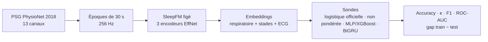

# SleepFM Pipeline

[](https://github.com/sumarc183-design/sleepfm-pipeline/actions/workflows/ci.yml)

[](https://docs.astral.sh/ruff/)
[](https://colab.research.google.com/github/sumarc183-design/sleepfm-pipeline/blob/main/notebooks/sleepfm_embeddings_physionet2018.ipynb)
[](https://kaggle.com/kernels/welcome?src=https://github.com/sumarc183-design/sleepfm-pipeline/blob/main/notebooks/sleepfm_embeddings_physionet2018.ipynb)

Reproduction et évaluation de [SleepFM](https://github.com/rthapa84/sleepfm-codebase),
modèle fondamental multimodal du sommeil, sur données ouvertes : stadification
en 5 classes (Wake, N1, N2, N3, REM) à partir des embeddings figés du
checkpoint officiel, avant toute comparaison à
[OSF](https://github.com/yang-ai-lab/OSF-Open-Sleep-FM).

> **In short.** An independent evaluation of the public SleepFM checkpoint on open
> PhysioNet 2018 data: 5-class sleep staging from frozen embeddings, with subject-level
> splits and bootstrap confidence intervals. On 100 test nights, a bidirectional GRU reaches
> κ 0.664 to 0.682 over three seeds, against 0.599 for the official logistic baseline. A single
> pre-registered pass on 494 never-opened subjects confirmed the gain: κ 0.672 against 0.578
> (difference +0.094, 95 % CI +0.086 to +0.103). This is
> neither a strict reproduction of the paper nor a clinical validation. Documentation is in French.



## Résultats en bref

Sur 100 nuits de test PhysioNet 2018 (89 132 époques), un BiGRU qui lit la nuit entière fait mieux
que la baseline officielle : son gain de κ va de +0,065 à +0,083 selon la graine.

| Sonde (test, 100 nuits) | Cohen's κ [IC 95 %] | F1 macro | ROC-AUC | AUPRC |
|---|---|---|---|---|
| Régression logistique pondérée (baseline officielle) | 0,599 [0,570 ; 0,627] | 0,686 | 0,921 | 0,750 |
| **BiGRU sur la nuit**, graine 42 | **0,664** [0,634 ; 0,694] | **0,731** | **0,940** | **0,800** |
| Article SleepFM 2024, tableau 8 (pas de κ publié) | | 0,700 | 0,924 | 0,759 |

**Confirmation sur 494 sujets jamais ouverts** (passage unique, protocole fixé à l'avance, modèles figés de la
graine 42) : κ 0,672 pour le BiGRU contre 0,578 pour la baseline, écart **+0,094 [+0,086 ; +0,103]**,
gain confirmé ([protocole et résultat](docs/PROTOCOLE_CONFIRMATION.md#résultat-2026-11-09-passage-unique)).

Sur 3 graines, le κ du BiGRU va de 0,664 à 0,682. Comparaison à l'article, effet du volume, ablation par
capteurs et nuits difficiles : **[résultats détaillés](docs/RESULTATS.md)**.

**Limites à garder en tête**
- **Pas une reproduction stricte de l'article :** seul le nombre de nuits de test est identique ; sujets, découpage, sonde et poids exacts restent différents ou inconnus.
- **Pas une validation clinique ni externe :** une seule cohorte (PhysioNet 2018). Sur les 100 nuits de test, 40 avaient déjà été examinées ; la confirmation sur 494 sujets réservés reste dans la même cohorte.

## État du projet

| Jalon | Échéance | État |
|---|---|---|
| J30, reproduction | 1er décembre 2026 | Atteint le 9 novembre : pipeline, mesures et confirmation sur 494 sujets réservés |
| J60, comparaison | 31 décembre 2026 | En cours : prédiction brute disponible ; MESA si accès obtenu, comparaison OSF à préparer |
| J90, différenciation | 30 janvier 2027 | À venir |

Détail : [ROADMAP](docs/ROADMAP.md).

## Démarrage rapide

**Sans installation** : bouton *Open in Colab* ci-dessus, `GPU T4`, `Tout exécuter`. Quota Colab épuisé : bouton *Open in Kaggle*, même notebook ([détails](docs/GUIDE.md#kaggle-autre-gpu-gratuit)).

**En local** :

```bash
python -m venv .venv
source .venv/bin/activate
python -m pip install -r requirements-dev.txt
bash scripts/setup_sleepfm.sh   # checkpoint officiel best.pt
python scripts/download_physionet2018.py --out data/raw/physionet2018/training --limit 20
python run_baseline.py --raw-data data/raw/physionet2018/training \
    --checkpoint third_party/sleepfm/sleepfm/checkpoint/best.pt
python -m pytest -q             # unitaires + bout-en-bout
```

Prédiction après enregistrement sur une PSG PhysioNet 2018 sans annotations :
`scripts/predict_raw_night.py`, voir le [guide](docs/GUIDE.md#prédire-sur-une-psg-brute-sans-annotations).

Mode par lots pour 100 sujets et plus, détails des sondes, tests et points
d'attention : [docs/GUIDE.md](docs/GUIDE.md).

## Données

| Base | Accès | Usage |
|---|---|---|
| PhysioNet Challenge 2018 | Public (994 sujets annotés) | Validation du pipeline (phase 1) |
| MESA (NSRR) | Sur demande (DUA) | Évaluation sur une cohorte supplémentaire (phase 2) |
| SHHS (NSRR) | Sur demande (DUA) | Évaluation à plus grande échelle (phase 2) |
| CHAT (NSRR) | Sur demande (DUA) | Pédiatrie, piste de différenciation (phase 2) |

Procédure NSRR : [docs/DATA_ACCESS.md](docs/DATA_ACCESS.md).

## Structure

```
run_baseline.py   point d'entrée : split par sujet -> extraction -> embeddings -> sondes -> évaluation
src/data/         lecture et découpage des PSG en époques
src/models/       encodeurs SleepFM, sondes (logistique, MLP, XGBoost, BiGRU), backbone OSF
scripts/          téléchargement, analyses, confirmation, prédiction, générateur de données synthétiques
notebooks/        notebook Google Colab / Kaggle
tests/            tests unitaires, bout-en-bout synthétique, données réelles
results/          sorties des runs réels
configs/          découpage figé, sujets réservés et empreintes de la confirmation
docs/             résultats, guide, carte du modèle, protocole, roadmap, accès NSRR, comparaison OSF
```

## Documentation

| Document | Contenu |
|---|---|
| [RESULTATS.md](docs/RESULTATS.md) | Tous les résultats, comparaison à l'article, limites |
| [GUIDE.md](docs/GUIDE.md) | Installation, modes d'exécution, sondes, tests, pièges connus |
| [MODEL_CARD.md](docs/MODEL_CARD.md) | Usage prévu, données, métriques, limites |
| [PROTOCOLE_CONFIRMATION.md](docs/PROTOCOLE_CONFIRMATION.md) | Protocole et résultat de la confirmation sur les 494 sujets réservés |
| [ROADMAP.md](docs/ROADMAP.md) | Jalons J30 / J60 / J90 |
| [DATA_ACCESS.md](docs/DATA_ACCESS.md) | Demande d'accès NSRR (MESA, SHHS, CHAT) |
| [OSF_COMPARISON.md](docs/OSF_COMPARISON.md) | Ce qu'il faut aligner avant de comparer SleepFM et OSF |
| [CHANGELOG.md](CHANGELOG.md) | Historique des versions |

## Licence et attributions

**Licence :** tous droits réservés, voir [LICENSE](LICENSE). Le dépôt peut être consulté, mais pas réutilisé
sans accord écrit. Le code de modèle et d'extraction adapté de SleepFM et d'OSF reste sous licence MIT :
voir [THIRD_PARTY_NOTICES.md](THIRD_PARTY_NOTICES.md). Pour citer ce travail : [CITATION.cff](CITATION.cff).

⚠️ Projet de recherche, pas un dispositif médical.
