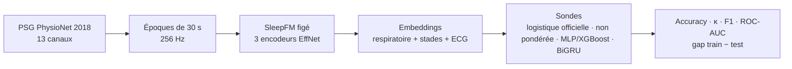

# SleepFM Pipeline

[](https://github.com/sumarc183-design/sleepfm-pipeline/actions/workflows/ci.yml)

[](https://docs.astral.sh/ruff/)
[](https://colab.research.google.com/github/sumarc183-design/sleepfm-pipeline/blob/main/notebooks/sleepfm_embeddings_physionet2018.ipynb)
[](https://kaggle.com/kernels/welcome?src=https://github.com/sumarc183-design/sleepfm-pipeline/blob/main/notebooks/sleepfm_embeddings_physionet2018.ipynb)

Reproduction et évaluation de [SleepFM](https://github.com/rthapa84/sleepfm-codebase),
modèle fondamental multimodal du sommeil, sur données ouvertes : stadification
en 5 classes (Wake, N1, N2, N3, REM) à partir des embeddings figés du
checkpoint officiel, avant toute comparaison à
[OSF](https://github.com/yang-ai-lab/OSF-Open-Sleep-FM) et tout développement
propriétaire.



## Résultats

200 sujets PhysioNet 2018, découpage **par sujet** figé
([`configs/split_physionet2018.json`](configs/split_physionet2018.json) :
160 nuits d'entraînement, 40 de test, 36 163 époques de test), embeddings
SleepFM figés (prétraitement version 2). Run de référence du 2026-11-05
([`results/…_200`](results/results_physionet2018_200.txt), avec les
prédictions du test époque par époque ; embeddings calculés sur Kaggle,
sondes sur CPU). Les 80 / 20 sujets du run précédent à 100 sujets gardent
leur rôle. Le test ne sert à aucun choix de modèle ou de réglage. IC à 95 %
par bootstrap sur les sujets de test.

| Sonde (test) | Accuracy | Cohen's κ [IC 95 %] | F1 macro [IC 95 %] | ROC-AUC | AUPRC | Gap F1 train − test |
|---|---|---|---|---|---|---|
| **Régression logistique pondérée** (baseline officielle) | 0,684 | **0,587** [0,533 ; 0,643] | 0,679 [0,640 ; 0,715] | 0,916 | 0,750 | +0,062 |
| Régression logistique non pondérée | 0,715 | 0,608 [0,544 ; 0,666] | 0,685 [0,641 ; 0,724] | 0,917 | 0,752 | +0,066 |
| MLP | 0,694 | 0,586 [0,525 ; 0,646] | 0,660 [0,622 ; 0,698] | 0,909 | 0,725 | +0,057 |
| **BiGRU sur la nuit** | **0,747** | **0,656** [0,594 ; 0,713] | **0,733** [0,696 ; 0,769] | **0,933** | **0,791** | +0,058 |

AUPRC = *average precision* (scikit-learn), un stade contre tous, moyennée.
Mêmes sondes que le run à 100 sujets (XGBoost, éliminé à 100 sujets, n'est
pas relancé).

- **Le contexte de la nuit est le levier** : le gain du BiGRU sur la baseline
  est **significatif** en comparaison appariée (mêmes nuits, bootstrap sur les
  sujets) : κ +0,069 [+0,045 ; +0,096], F1 macro +0,054 [+0,035 ; +0,076].
  Il progresse sur 33 nuits de test sur 40. Celui du MLP est nul : κ −0,000
  [−0,019 ; +0,016], et son F1 macro recule (−0,019).
- **Plus de données d'entraînement aide ; la baisse vient du test**
  ([détail](results/nuits_test_physionet2018_200.txt)). Sur les 20 nuits de
  test du run à 100 sujets, entraîner sur 160 nuits au lieu de 80 fait
  mieux : κ 0,620 contre 0,607 pour la baseline, 0,706 contre 0,685 pour le
  BiGRU (le prétraitement v2 y ajoute 125 époques de début de nuit). Les 20
  nouvelles nuits de test sont plus dispersées (baseline 0,552
  [0,442 ; 0,645]) mais pas plus dures en médiane (κ médian par nuit 0,630
  contre 0,610) : deux nuits à l'hypnogramme atypique tirent le total vers
  le bas. tr03-1292, notée à 69 % d'éveil par l'expert, que les modèles
  lisent surtout en N2 (κ 0,04) ; tr04-0133, notée à 76 % de N1 (κ 0,12).
  Elles restent dans le test : on n'écarte pas de nuits après avoir vu les
  résultats.

Les analyses détaillées ci-dessous portent sur le run à 100 sujets du
2026-11-04 ([`results/…_100_auprc`](results/results_physionet2018_100_auprc.txt) :
80 / 20 nuits, baseline κ 0,607, BiGRU κ 0,685, écart apparié +0,078
[+0,042 ; +0,114]) ; elles n'ont pas été refaites à 200 sujets.
- **Il tient d'une graine à l'autre, avec une marge**
  ([ablation, 3 graines](results/ablation_sequence_physionet2018_100.txt)) :
  κ du BiGRU de 0,666 à 0,684, gain de +0,060 à +0,077, significatif à
  chaque fois. Le 0,685 du run de référence est donc plutôt haut ; compter
  environ ±0,01 de variation due à l'entraînement.
- **D'où vient le gain** : il grandit avec le contexte lu à la prédiction
  (+0,02 à +0,03 avec 5 min, +0,06 à +0,07 avec 1 h, +0,06 à +0,08 avec la
  nuit). Avec les époques mélangées dans chaque nuit, il reste +0,03 à +0,04 :
  voir toute la nuit du sujet aide déjà. L'ordre chronologique ajoute
  +0,02 à +0,04 en comparaison directe, significatif sur une graine sur trois
  seulement : sa part exacte n'est pas établie. Le BiGRU lit aussi les
  époques futures : analyse après l'enregistrement, pas temps réel.
- **Où le BiGRU gagne** ([analyse des erreurs](results/errors_sequence_vs_logistic_physionet2018_100.txt)) :
  surtout sur N2, que la baseline confond avec N3, N1 et REM (N2 bien classé :
  5 826 époques contre 4 300). Le gain se fait au milieu des segments stables
  (+0,07 à +0,10 de précision), presque pas aux changements de stade (+0,01),
  qui restent le point dur (55 % de précision, 21 % des époques). 17 nuits de
  test sur 20 progressent (gain médian de κ +0,06).
- **N1 : pas de gain établi.** Dans le run de référence, F1 0,52 contre 0,51
  pour la baseline, mais 0,46 à 0,48 sur les 3 graines de l'ablation. Le
  rappel baisse (0,47 contre 0,53) : le BiGRU lisse davantage les vraies
  époques N1 en éveil (873 contre 718).
- **Deux nuits ratées par les deux modèles** (κ ≈ 0,34,
  [examen](results/nuits_ratees_physionet2018_100.txt)) : presque tout leur
  REM est pris pour de l'éveil. Dans l'une, l'EMG du menton est
  quasi plat (électrode probable) ; dans l'autre, le REM ressemble à l'éveil
  (peu d'atonie, pas de mouvements oculaires), à montrer au médecin du
  sommeil.
- **Pondérer les stades dans le BiGRU ne paie pas**
  ([essai](results/bigru_pondere_physionet2018_100.txt)) : le rappel de N1
  remonte (0,58 contre 0,47) mais son F1 ne bouge pas (0,52), N2 recule
  (0,74 contre 0,83) et le κ perd 0,056 [−0,083 ; −0,033]. Même compromis que
  pour la régression logistique : le BiGRU reste non pondéré.
- **La ROC-AUC varie peu** (0,924 à 0,936) : les probabilités classent bien
  les époques pour toutes les sondes ; elles se distinguent sur la décision
  finale, que mesurent le κ et le F1.
- **Le MLP essayé n'apporte rien** : il fait jeu égal avec la régression
  logistique (une autre architecture non linéaire n'est pas exclue). XGBoost,
  un peu moins bon en validation croisée (F1 0,669 contre 0,672), est en plus
  éliminé pour surapprentissage (gap F1 +0,32).
- **Pondérer les classes déplace les erreurs** : la baseline officielle
  reconnaît mieux N1 (F1 0,51 contre 0,45), mais confond davantage N2 avec
  N3, N1 et REM, d'où un κ plus bas (0,607 contre 0,645).
- **N1 reste le stade le plus difficile** (F1 ≈ 0,51), confondu surtout avec
  l'éveil (718 époques sur 2 571) et le REM (308). C'est aussi le stade le
  moins concordant entre experts humains.
- **Reproductible** : un même run donne les mêmes chiffres sur GPU (Kaggle)
  et sur CPU (Colab, Mac), à 0,001 près. Les embeddings recalculés en
  prétraitement v2 sont identiques à ceux de la v1 sur 91 des 100 premières
  nuits ; sur les 9 autres, la v2 récupère 480 époques de début de nuit que
  la v1 coupait, avec les mêmes stades sur les époques communes.

Sorties brutes dans [`results/`](results/) : texte, JSON (sujets, réglages,
matrices de confusion), prédictions du test, ablation (avec ses prédictions)
et analyse d'erreurs. Runs antérieurs gardés pour l'historique :
`…_100_auprc` (référence à 100 sujets), `…_100` (Kaggle), `…_cpu`,
`…_paired`.

Avant le 2026-11-04 : κ 0,584 (20 sujets) puis 0,622 (100 sujets, split
75/25), avec la régression **non pondérée**, qui n'est pas le protocole
officiel ([détail](results/results_physionet2018_100_v0.1.0_non_pondere.txt)).

### Comparaison à l'article

L'article SleepFM 2024 ([Thapa et al., ICML 2024](https://arxiv.org/abs/2405.17766),
section 4.6, tableau 8) évalue SleepFM sur PhysioNet 2018, en validation
externe, avec 100 participants en test. Nous utilisons le checkpoint public
`best.pt` du dépôt officiel ; rien ne garantit qu'il soit identique aux
poids de l'article (son empreinte SHA-256 est enregistrée dans le manifeste
du cache). Ses résultats principaux
portent sur les données internes de Stanford, non publiques ; MESA n'y
apparaît pas. Il ne publie pas de κ sur PhysioNet 2018.

| Test | ROC-AUC macro | AUPRC macro | F1 macro | F1 Wake / N1 / N2 / N3 / REM |
|---|---|---|---|---|
| Article (tableau 8) | 0,924 | 0,759 | 0,700 | 0,79 / 0,44 / 0,79 / 0,74 / 0,72 |
| Logistique pondérée (baseline officielle) | 0,916 | 0,750 | 0,679 | 0,74 / 0,48 / 0,72 / 0,75 / 0,70 |
| Logistique non pondérée | 0,917 | 0,752 | 0,685 | 0,75 / 0,43 / 0,78 / 0,75 / 0,72 |
| BiGRU sur la nuit | 0,933 | 0,791 | 0,733 | 0,78 / 0,52 / 0,79 / 0,75 / 0,82 |

- **Même ordre de grandeur que l'article** : la baseline est un peu en
  dessous (ROC-AUC 0,916 contre 0,924, AUPRC 0,750 contre 0,759), le BiGRU
  au-dessus. À 100 sujets, la baseline était au niveau publié (0,925 /
  0,770) : l'écart tient surtout aux deux nuits atypiques du nouveau test.
- **Le profil du F1 de la logistique non pondérée colle à celui de
  l'article**, stade par stade (N1 0,43 contre 0,44 ; N2 0,78 contre 0,79).
  La pondérée s'en écarte : meilleure sur N1, moins bonne sur N2. C'est une
  hypothèse à vérifier : l'évaluation de l'article n'a peut-être pas pondéré
  les classes, alors que le code officiel le fait.
- **Pas une reproduction stricte** : 40 nuits de test contre 100, notre propre
  découpage, et l'article ne précise ni le nombre de nuits d'entraînement ni
  la sonde utilisée pour cette évaluation.

Chiffres du run de référence ci-dessus. L'AUPRC de l'article n'indique pas
sa méthode de calcul ; la nôtre est l'*average precision*. La sortie du script
compare la baseline au tableau 8 stade par stade. Sondes et règle de
sélection : [guide](docs/GUIDE.md#sondes-et-sélection-de-modèle).

## Démarrage rapide

**Sans installation** : bouton *Open in Colab* ci-dessus, `GPU T4`, `Tout exécuter`. Quota Colab épuisé : bouton *Open in Kaggle*, même notebook ([détails](docs/GUIDE.md#kaggle-autre-gpu-gratuit)).

**En local** :

```bash
pip install -r requirements-dev.txt
bash scripts/setup_sleepfm.sh   # checkpoint officiel best.pt
python scripts/download_physionet2018.py --out data/raw/physionet2018/training --limit 20
python run_baseline.py --raw-data data/raw/physionet2018/training \
    --checkpoint third_party/sleepfm/sleepfm/checkpoint/best.pt
pytest tests/                   # unitaires + bout-en-bout sur données synthétiques
```

Mode par lots pour 100 sujets et plus, détails des sondes, tests et points
d'attention : [docs/GUIDE.md](docs/GUIDE.md).

## Données

| Base | Accès | Usage |
|---|---|---|
| PhysioNet Challenge 2018 | Public (994 sujets annotés) | Validation du pipeline (phase 1) |
| MESA (NSRR) | Sur demande (DUA) | Évaluation sur une cohorte supplémentaire (phase 2) |
| SHHS (NSRR) | Sur demande (DUA) | Évaluation à plus grande échelle (phase 2) |
| CHAT (NSRR) | Sur demande (DUA) | Pédiatrie, piste de différenciation (phase 2) |

Procédure NSRR : [docs/DATA_ACCESS.md](docs/DATA_ACCESS.md).

## Structure

```
run_baseline.py   point d'entrée : split par sujet -> extraction -> embeddings -> sondes -> évaluation
src/data/         lecture et découpage des PSG en époques
src/models/       encodeurs SleepFM, sondes (logistique, MLP, XGBoost, BiGRU), backbone OSF
scripts/          téléchargement PhysioNet, setup SleepFM, générateur de données synthétiques
notebooks/        notebook Google Colab / Kaggle
tests/            tests unitaires, bout-en-bout synthétique, données réelles
results/          sorties des runs réels
configs/          conventions de référence (non lues par les scripts)
docs/             guide, carte du modèle, roadmap, accès NSRR, comparaison OSF
```

## Documentation

| Document | Contenu |
|---|---|
| [GUIDE.md](docs/GUIDE.md) | Installation, modes d'exécution, sondes, tests, pièges connus |
| [MODEL_CARD.md](docs/MODEL_CARD.md) | Usage prévu, données, métriques, limites |
| [ROADMAP.md](docs/ROADMAP.md) | Jalons J30 / J60 / J90 |
| [DATA_ACCESS.md](docs/DATA_ACCESS.md) | Demande d'accès NSRR (MESA, SHHS, CHAT) |
| [OSF_COMPARISON.md](docs/OSF_COMPARISON.md) | Ce qu'il faut aligner avant de comparer SleepFM et OSF |
| [CHANGELOG.md](CHANGELOG.md) | Historique des versions |

## Attributions

Code de modèle et d'extraction adapté de SleepFM et d'OSF (licences MIT) :
voir [THIRD_PARTY_NOTICES.md](THIRD_PARTY_NOTICES.md). Pour citer ce travail :
[CITATION.cff](CITATION.cff).

⚠️ Projet de recherche, pas un dispositif médical.
